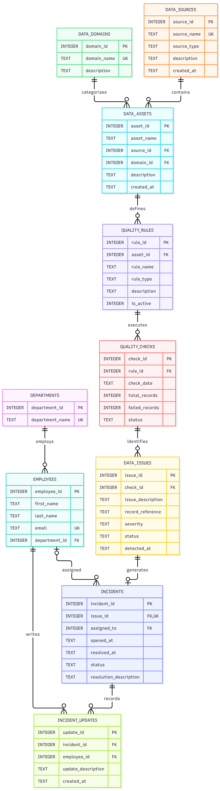

# DataTrust — Design Document

Luka Gobejishvili

## Scope

DataTrust is a relational database designed to help organizations monitor data quality and manage issues affecting business information. Organizations depend on data from customer, finance, inventory, and human resources systems, but this information can be incomplete, duplicated, inconsistent, outdated, or invalid. DataTrust provides a centralized record of data sources, assets, validation rules, check results, identified issues, and corrective actions.

The intended users are data analysts, data stewards, data governance specialists, and employees responsible for resolving data quality incidents. The database supports quality monitoring, issue prioritization, incident assignment, historical tracking, and SQL-based reporting. It is a management and reporting database: it does not connect to external systems or independently scan and correct source records.

## Functional Requirements

Users should be able to:

- Register data sources, categorize data assets into business domains, and associate each asset with its source.
- Define quality rules for completeness, accuracy, consistency, validity, uniqueness, and timeliness.
- Record each rule execution, including timestamps, execution status, total records checked, and failed records.
- Track detected issues, their severity, associated source-record references, and resolution status.
- Create incidents for issues, assign employees, update statuses, and record investigation activities.
- Calculate quality scores, identify high-priority problems, review workloads, and compare quality performance over time.

Constraints and triggers enforce selected business rules. Automated rule execution, authentication, scheduled scanning, and a graphical interface are outside this project's scope.

## Representation

### Entities

The database contains ten entities organized into four groups.

**Organizational Structure**

- **`departments`:** Stores `department_id` (`INTEGER PRIMARY KEY`) and `department_name` (`TEXT NOT NULL UNIQUE`). Unique names prevent duplicate department entries.
- **`employees`:** Stores `employee_id`, first and last names, unique required email addresses, and `department_id` referencing `departments`. Separating departments avoids repeating their names for every employee.

**Data Asset Management**

- **`data_sources`:** Stores `source_id`, a unique source name, source type, optional description, and creation timestamp. This represents systems such as CRM databases or finance files without storing their underlying records.
- **`data_domains`:** Stores `domain_id`, unique business-domain names, and optional descriptions, allowing assets to be grouped into categories such as Customer or Finance.
- **`data_assets`:** Stores `asset_id`, an asset name, description, timestamp, and required `source_id` and `domain_id` foreign keys. `UNIQUE (source_id, asset_name)` prevents duplicate names within one source while permitting the same name in different sources.

**Data Quality Monitoring**

- **`quality_rules`:** Assigns rules to assets through `asset_id`. Each rule has a `rule_id`, name, type, description, and `is_active` flag. `CHECK` restricts the rule type to six supported categories and the flag to `0` or `1`; rule names are unique per asset.
- **`quality_checks`:** Records a `check_id`, associated rule, execution date, status, number of evaluated records, and number of failures. `CHECK` constraints prohibit negative counts and failures exceeding the total. Completed checks require counts, whereas technically failed executions have `NULL` counts.
- **`data_issues`:** Stores `issue_id` and issues associated with checks, including a description, optional textual `record_reference`, severity, status, and detection timestamp. `CHECK` constraints restrict severity to Low, Medium, High, or Critical, and status to Open, In Progress, or Resolved. The record reference is textual because affected records belong to external systems.

**Incident Management**

- **`incidents`:** Stores `incident_id` and connects an issue to an optionally assigned employee, tracking opening time, resolution time, status, and resolution notes. `UNIQUE (issue_id)` limits each issue to one incident. Checks ensure resolved incidents have a resolution timestamp not earlier than their opening time.
- **`incident_updates`:** Stores `update_id`, dated activity notes, `incident_id`, and `employee_id`. A separate history table allows multiple updates per incident without duplicating incident details.

All primary keys use SQLite `INTEGER PRIMARY KEY` identifiers. Descriptions, categories, and timestamps use `TEXT`, while counts and Boolean-like flags use `INTEGER`. SQLite's `CURRENT_TIMESTAMP` provides UTC timestamps. Foreign keys are enabled for each connection using `PRAGMA foreign_keys = ON`. Separating organizational, asset, quality, and incident records reduces duplication and supports relational normalization.

### Relationships

The database uses the following relationships:

- One department can have many employees; each employee belongs to one department.
- One data source and one business domain may each be associated with many assets; every asset belongs to one source and one domain.
- One asset can have many quality rules, and one rule can have many check executions.
- One check can identify multiple issues; each issue references one check.
- One issue can have zero or one incident because `incidents.issue_id` is unique.
- One employee can be assigned multiple incidents; an incident may be unassigned because `assigned_to` is nullable.
- Each incident can have multiple updates, and each employee can write multiple updates.

Foreign keys maintain relationships between existing records and allow joins across monitoring and incident workflows. The diagram shows all ten entities and their cardinalities.

## Optimizations

### Indexes

Seven custom indexes support common filters, joins, and ordering:

- `idx_data_assets_domain` retrieves assets by domain.
- `idx_quality_rules_asset` retrieves rules for an asset.
- `idx_quality_checks_rule_date` locates a rule's checks ordered by date.
- `idx_data_issues_check` locates issues identified by a check.
- `idx_data_issues_severity_status` filters issues by severity and status.
- `idx_incidents_assigned_status` retrieves an employee's incidents by status.
- `idx_incident_updates_incident_date` retrieves chronological incident activity.

`EXPLAIN QUERY PLAN` confirmed the use of the severity/status, rule/date, and incident/date indexes in representative queries. Indexes improve some reads but consume storage and add write overhead.

### Views

Three views simplify analytical reporting:

- **`data_quality_summary`:** Calculates per-asset quality scores from completed checks.
- **`open_issues_summary`:** Counts unresolved and critical issues by asset.
- **`incident_management_summary`:** Combines incidents with issues, employees, and resolution durations.

These are reusable query definitions rather than physically stored summaries.

### Triggers

Three triggers enforce selected business rules:

- **`trg_auto_resolve_issue`:** Resolves the related issue when an incident is resolved.
- **`trg_prevent_resolved_incident_reopen`:** Blocks reopening resolved incidents.
- **`trg_prevent_completed_check_update`:** Blocks updates to completed quality checks.

Trigger behavior was verified with transactions and `ROLLBACK`.

## Limitations

**External Integration:** DataTrust stores descriptions of quality rules and recorded check results; it does not execute checks against external databases or automatically repair incorrect source records. An application or integration service would be required for automation.

**Quality Score Interpretation:** A quality score measures successful record evaluations across checks, not the percentage of distinct valid records. The same record may be evaluated by several rules or on different dates. Comparisons therefore depend on which rules and records were checked.

**Incident Relationships:** The one-issue-to-at-most-one-incident model cannot group several issues into a single incident. A more flexible relationship model would be needed for complex investigations.

**Historical Tracking and Workflow:** Incident updates are manually recorded rather than a complete automatic audit log. Triggers cover selected transitions but do not enforce every workflow rule, including the requirement that issues originate only from completed checks.

**Timestamp Consistency:** Issue detection timestamps are aligned with check dates in sample data, but the schema does not enforce this consistency for future records.

**Security and Scalability:** The project has no built-in user authentication, role-based authorization, or graphical interface. SQLite is appropriate for this educational implementation, but a high-concurrency, multi-user deployment would require additional services and possibly a different database platform.

Future improvements could include automated rule execution, scheduled quality checks, comprehensive audit logging, more flexible incident relationships, and integration with reporting tools such as Power BI.
