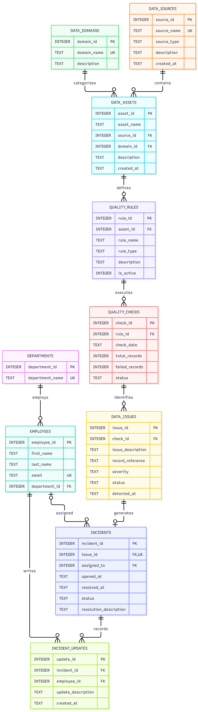

# DataTrust
### Data Quality & Governance Management System

DataTrust is a SQL-based relational database project designed to support data quality monitoring, issue tracking, and incident management.

The project demonstrates how relational database design and SQL can be used to organize data governance processes, monitor data reliability, and track the resolution of data-related issues.

## Key Features

- **Data Asset Management:** Organize data assets by source, domain, and responsible employees.
- **Data Quality Monitoring:** Define quality rules and record their execution results.
- **Issue Tracking:** Track data quality issues detected during validation.
- **Incident Management:** Manage incidents, monitor their statuses, and maintain update histories.
- **Data Quality Reporting:** Calculate quality metrics and generate operational summaries.
- **Automated Business Rules:** Use SQL triggers to enforce data consistency and workflow restrictions.

## Technologies Used

- **SQLite** — Relational database management
- **SQL** — Data definition, manipulation, and analysis
- **Database Constraints** — Primary keys, foreign keys, and integrity rules
- **Views** — Reusable queries for reporting
- **Triggers** — Database-level workflow automation
- **Indexes** — Support for efficient data access
- **Transactions** — Controlled data modifications

## Database Architecture

The database consists of **10 interconnected tables**:

| Table | Purpose |
|---|---|
| `departments` | Stores organizational departments |
| `employees` | Stores employee information |
| `data_sources` | Tracks data sources |
| `data_domains` | Organizes data governance domains |
| `data_assets` | Maintains data asset information |
| `quality_rules` | Defines data quality rules |
| `quality_checks` | Records quality check results |
| `data_issues` | Tracks detected data quality problems |
| `incidents` | Manages data-related incidents |
| `incident_updates` | Maintains incident update histories |

### Entity Relationship Diagram



## SQL Implementation

The project includes:

- 10 relational tables
- 7 indexes
- 3 SQL views
- 3 SQL triggers
- 16 documented SQL queries
- Sample data for testing and demonstration

### Views

- `data_quality_summary` — Summarizes data quality performance.
- `open_issues_summary` — Provides information about unresolved data quality issues.
- `incident_management_summary` — Supports incident monitoring and resolution reporting.

### Triggers

- `trg_auto_resolve_issue` — Automatically resolves a related issue when an incident is resolved.
- `trg_prevent_resolved_incident_reopen` — Prevents reopening resolved incidents.
- `trg_prevent_completed_check_update` — Restricts changes to completed quality checks.

## Example Insights

Using the included sample data, the database can generate operational insights such as:

- **98.29%** overall data quality score.
- Incident distribution by status.
- Open and resolved data quality issues.
- Incident resolution times.
- Data quality performance summaries.

*These values are based on demonstration data, not production data.*

## Project Structure

```text
DataTrust/
├── README.md
├── DESIGN.md
├── schema.sql
├── queries.sql
├── seed.sql
└── diagram.png
```

- `schema.sql` — Database schema, indexes, views, and triggers.
- `queries.sql` — Example analytical and operational SQL queries.
- `seed.sql` — Sample data for testing.
- `DESIGN.md` — Detailed database design documentation.
- `diagram.png` — Entity Relationship Diagram.

## Getting Started

**Requirements:** SQLite 3

1. Clone the repository.
2. Navigate to the project directory.
3. Create and populate the database:

```bash
sqlite3 datatrust.db < schema.sql
sqlite3 datatrust.db < seed.sql
```

4. Open the database:

```bash
sqlite3 datatrust.db
```

5. Run SQL queries from `queries.sql` to explore the data.


## Project Focus

This project explores the practical application of SQL in:

- Relational database design
- Data governance
- Data quality management
- Data integrity
- Incident tracking
- SQL-based reporting and automation

## Author

**Luka Gobejishvili**

[GitHub Profile](https://github.com/LukaGobejishvili)
